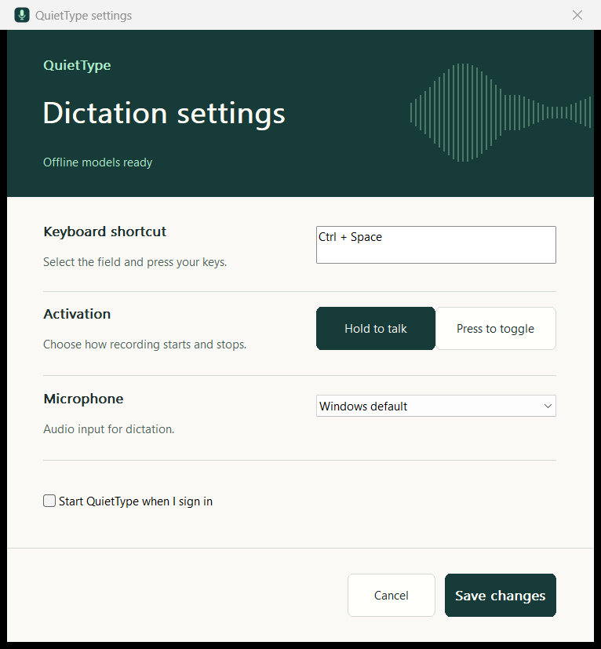

# QuietType

Personal English dictation for Windows x64. Download the MSI from [Releases](https://github.com/sachingupta32/QuietType/releases), install it, then open **QuietType** from Start. The installer is unsigned and requires an AVX2-capable CPU. The installer uses your Windows account. On first launch, accept the model download (about 1.18 GB). After verification, dictation works offline on the CPU.

## Dictate

1. Click in a text field. Hold **Ctrl+Space**, wait for **Listening**, and speak. Release to finish. Press **Esc** at any point to cancel.
2. Keep the same field focused while **Transcribing** and **Polishing** appear. QuietType pastes the result, including paragraph breaks, without sending Enter. Automatic insertion replaces the clipboard with the dictation.
3. Right-click the green microphone icon in the Windows notification area for **Settings** or **Copy last dictation**. Settings lets you record a shortcut, use press-to-toggle, select a microphone and enable launch at sign-in.

If focus changes, a field cannot be identified, or the target rejects input, use **Copy last dictation**. The latest result stays in memory until replaced or the app exits. If polishing fails, that result is the speech transcript. If a download is interrupted, choose **Set up models** to resume it. Recording stops after five minutes. The default shortcut may already be assigned to another application or keyboard layout.

## Local processing

Windows captures mono 16 kHz PCM only during recording. The tray app sends an in-memory WAV to whisper.cpp, waits for that process to exit, then sends the transcript through a pipe to the Qwen worker. Model processes run in a Windows job so cancellation or exiting the app releases them. The app creates no dictation-history or audio files. Paste uses the Windows clipboard and marks dictated text to exclude it from clipboard history and roaming. Clipboard managers and target apps can retain pasted text.

Speech recognition uses quantized English base Whisper. Cleanup uses Qwen2.5 1.5B Instruct Q4_K_M through llama.cpp. Editing is conservative and can retain recognition errors or miss a correction. Windows accessibility identifies the original field, with native focus identification for Scintilla editors. Settings and models live under **%LOCALAPPDATA%\QuietType**. Uninstall through Windows Installed apps. Models and settings remain available for reinstallation.

## Build

Use Windows x64 PowerShell with CMake on PATH. The workers target an AVX2-capable processor. Build scripts fetch pinned dependency archives, compile local CPU workers, bundle runtime DLLs, and create the MSI.

~~~powershell
.\bootstrap.ps1
.\build-workers.ps1 whisper
.\build-workers.ps1 llama
.\build-app.ps1
.\package.ps1
~~~

## Verification

The model downloader checks SHA-256 for both files. For repeatable tests without using a live microphone, prepare a separate model directory in the workspace and run the worker benchmark with Python and psutil.

~~~powershell
.\models.ps1 -ModelDirectory .build\models
python tests\bench.py
.\tests\build.ps1
.\.build\controls.exe
~~~

The controls test opens a scratch window and briefly exercises the microphone and global shortcuts. The desktop probe exercises the same worker, focus-check, paste and cancellation code as the tray app using a WAV fixture. Open and focus an empty scratch document with **QuietType-acceptance-** in its title, then run the probe with the unique window-title fragment. It verifies insertion by reading back the scratch field. Additional modes are **cancel**, **switch**, and **tab** (for a browser fixture with two fields).

~~~powershell
.\.build\desktop-probe.exe .build\whisper\whisper.cpp-1.7.6\samples\jfk.wav QuietType-acceptance-Notepad insert
~~~

Model and engine sources are [whisper.cpp](https://github.com/ggml-org/whisper.cpp), [English Whisper weights](https://huggingface.co/ggerganov/whisper.cpp), [llama.cpp](https://github.com/ggml-org/llama.cpp), and [Qwen2.5 1.5B Instruct GGUF](https://huggingface.co/Qwen/Qwen2.5-1.5B-Instruct-GGUF).
